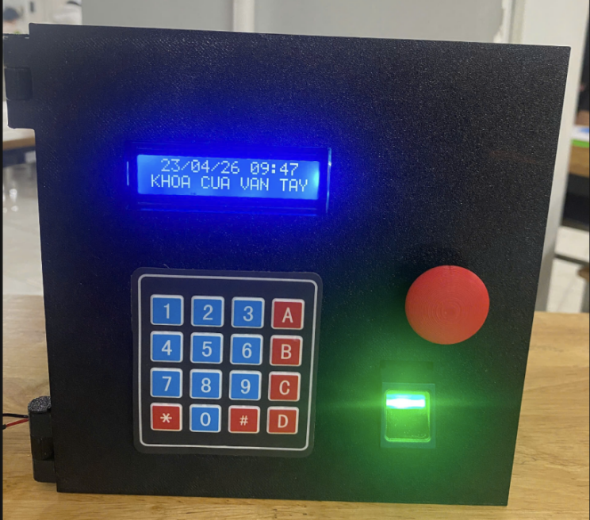
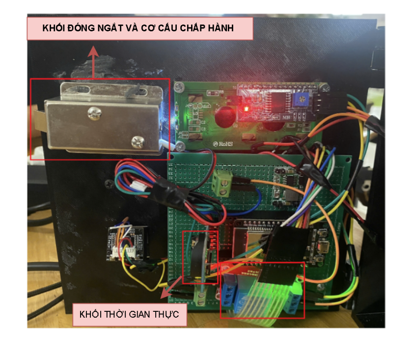
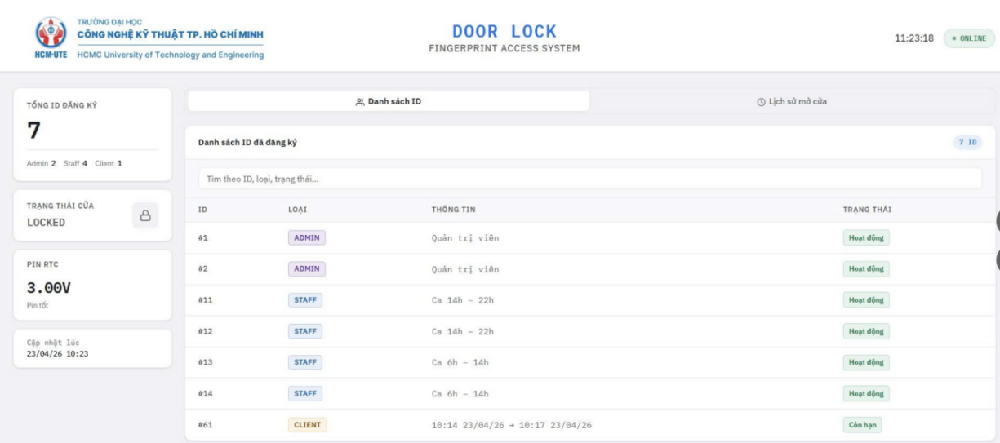
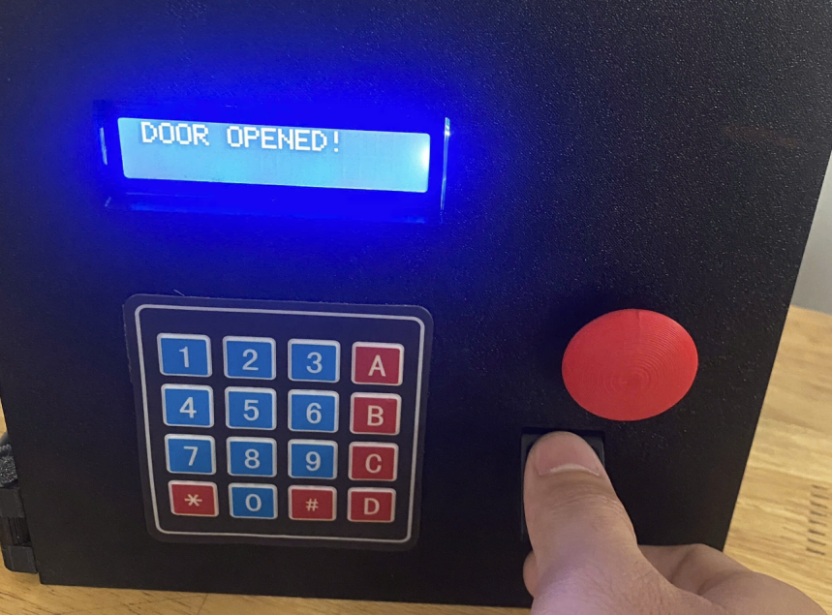
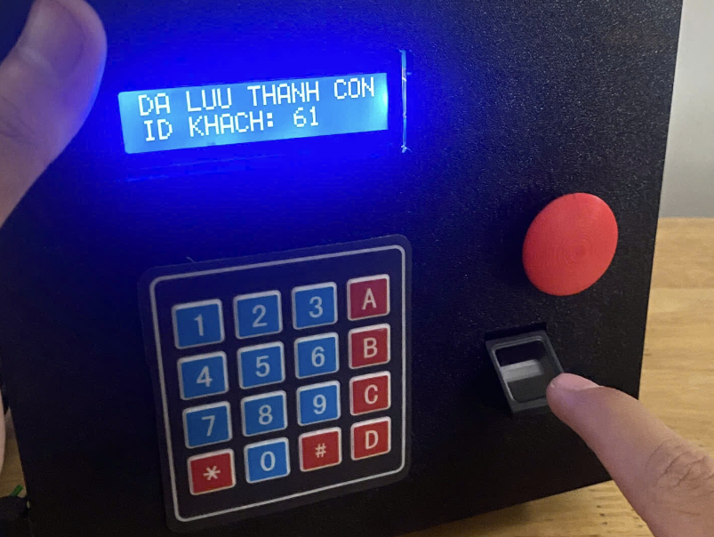
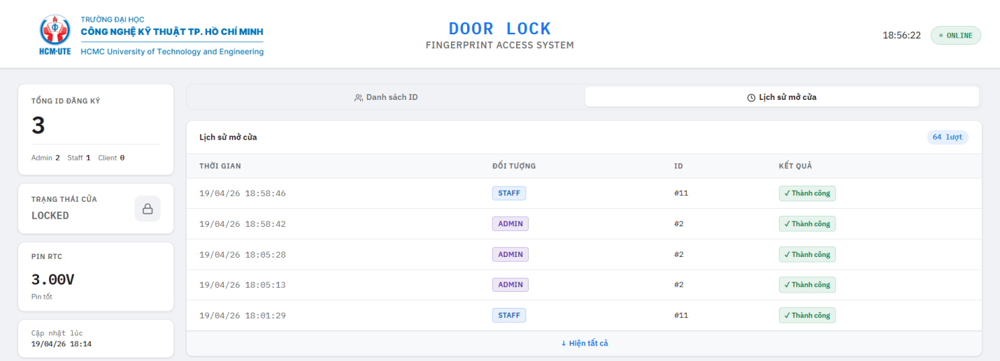

# ESP32 Fingerprint Door Lock

A working access-control prototype combining fingerprint authentication, a PIN menu, time-based permissions and a Firebase web dashboard. Built as Course Project 1, April 2026.

**[Watch the demo](https://youtu.be/4xGycZWLZ9U)** · [Setup guide](docs/setup.md) · [Firmware](src/) · [Dashboard](dashboard/dashboard.html)

## Prototype and results

| Front panel | Rear assembly |
| :---: | :---: |
|  |  |

The front panel integrates the LCD, keypad and AS608 sensor. The rear houses the LY-03 lock and control electronics, assembled on a 10 × 10 cm FR4 prototyping board.

| Test | Result reported in the project report |
| --- | --- |
| PIN operations | 30/30 successful trials (100%) |
| Fingerprint recognition | 95% accuracy under normal conditions |
| Fingerprint recognition time | Less than 1 second |
| Access permissions | Admin, staff shifts and temporary guest access demonstrated |

*Source: Chapter 5, Section 5.1 of the project report. The fingerprint trial count is not specified; these figures describe the reported prototype tests.*

### Monitoring dashboard



Registered users are grouped by role, with staff shifts and guest validity periods shown alongside the reported lock status. Fingerprint access events are available in the history tab.

<details>
<summary>More results: fingerprint unlocking, guest enrollment and access history</summary>

| Fingerprint accepted | Guest enrollment completed |
| :---: | :---: |
|  |  |



All photographs and screenshots are extracted from the project report. [Figure references](docs/images/SOURCES.md).

</details>

## Key features

- Fingerprint unlocking and PIN-based access through the keypad/LCD menu; the relay activates for 3 seconds.
- Local fingerprint enrollment/deletion, with schedules retained in ESP32 NVS and checked against the DS3231 RTC.
- Firebase storage for user records and fingerprint access events; browser dashboard with search and history.

| Role | IDs | Access rule |
| --- | --- | --- |
| Admin | 1–10 | Unrestricted; enrolled separately |
| Staff | 11–60 | Assigned shift: 06:00–14:00 or 14:00–22:00 |
| Guest / Client | 61–127 | Configured check-in/check-out window |

## Hardware and software

**Hardware:** ESP32 DevKit V1, AS608, 4×4 keypad, 16×2 I²C LCD, DS3231, relay, LY-03 12 V solenoid lock and MP1584EN step-down supply.

**Software:** C++ / Arduino firmware, HTML/CSS/JavaScript dashboard and Firebase Realtime Database via HTTP REST.

```text
Fingerprint / Keypad → ESP32 + RTC → Relay → Door lock
                          │
                       Wi-Fi / REST
                          ↓
                 Firebase → Web dashboard
```

Firmware status updates run every 10 seconds; the dashboard polls approximately every 5 seconds.

## Getting started

Follow the [setup guide](docs/setup.md) for Arduino libraries, wiring pins, Wi-Fi/Firebase configuration and upload steps.

| Folder | Contents |
| --- | --- |
| [src/](src/) | Firmware and hardware control |
| [dashboard/](dashboard/) | Web monitoring interface |
| [docs/](docs/) | Setup guide, report images and figure references |
| [png/](png/) | Dashboard logo asset |

<details>
<summary>Limitations and next steps</summary>

Wet or dirty fingers can reduce recognition reliability. Cloud updates depend on Wi-Fi, and the prototype has no backup power or offline log buffering. In the current code, RTC battery voltage is fixed at 3.0 V, door status reflects software events rather than a physical sensor, and PIN changes reset after reboot. Firebase authentication and access rules still need implementation before deployment.

The report proposes backup power, offline logging, RFID fallback and alerts for repeated failed access attempts as future improvements.

</details>

---

**Nguyen Duc Phuong & Nguyen Minh Khang** · Computer Engineering · HCMUTE
